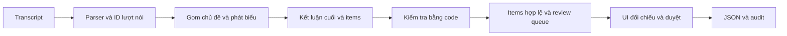

# Kiến trúc Meeting Trace

Mã ứng dụng và công cụ nằm trong `src`. Entry point `python src` phân phối lệnh serve/extract/evaluate/test/package. Package `meeting_trace` chia trách nhiệm theo luồng xử lý.

| Phần | Trách nhiệm |
| --- | --- |
| `meeting/core.py` | Parse, local pipeline hai bước, kiểm tra schema/evidence/owner/due, chọn engine |
| `meeting/prompts.py`, `llm.py` | Hai prompt và adapter OpenAI tùy chọn; chưa chạy API thật |
| `meeting/schema.py` | Hợp đồng JSON, các loại/trạng thái và validator cấu trúc |
| `web/server.py`, `web/static/` | HTTP local, nhập transcript, đối chiếu evidence, duyệt và xuất |
| `evaluation/runner.py` | Hash fixtures, ghi lỗi input thành case thất bại, điều phối chấm và lưu |
| `evaluation/scoring.py` | Matching một-một, điều kiện được gán nhãn và metric |
| `evaluation/reporting.py` | Báo cáo kết quả thật theo case, nhóm và định dạng người nói |
| `tools/` | Test runner và packager dùng allowlist showcase |

Local dựa vào regex; LLM là chế độ khác dùng cùng schema. Quote bước gom chủ đề sai sẽ dừng pipeline trước bước 2; candidate item sai được giữ vào review queue. Không dùng output local để nhận là kết quả LLM.

HTTP app đọc mẫu từ `data/examples/index.json`, không đọc ground truth ở `tests/fixtures`. Replay đọc các output v2 đã lưu. Output có `error` cho input chưa hỗ trợ vẫn được hiển thị rõ, không giả thành lượt chạy thành công.

Core/prompt v1 giữ nguyên byte, freeze gốc vẫn kiểm tra qua `path_migration.json`. Suite v2 đổi dữ liệu và cách báo lỗi input/chấm điều kiện; có hash fixture riêng. Không cộng số liệu v1 vào v2. Các case lỗi là kết quả cần phân tích, không phải lỗi hạ tầng bị giấu.

`status=confirmed` tự động khác dấu xác nhận của người dùng. Xuất hiện chưa bắt buộc PM duyệt xong; metadata luôn ghi chưa xác minh ngữ nghĩa tự động. Chưa có storage, auth hoặc tích hợp công cụ ngoài.
